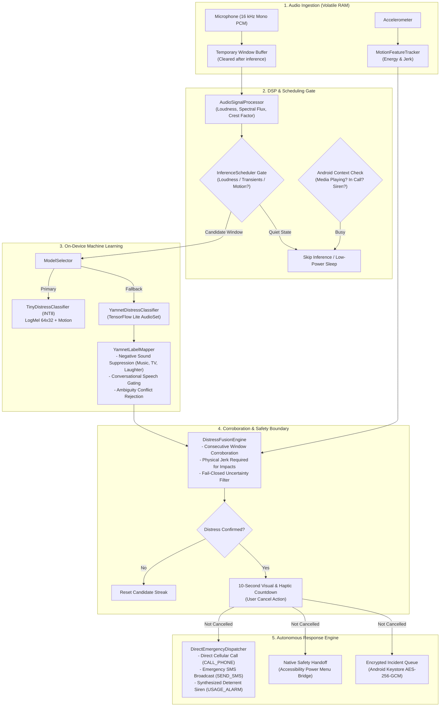

# AcousticGuard

[](https://developer.android.com)
[](https://kotlinlang.org)
[](https://developer.android.com/jetpack/compose)
[](https://www.tensorflow.org/lite)
[](docs/MODEL.md)
[](LICENSE)

**AcousticGuard** is a zero-touch, privacy-first Android application designed for real-time on-device distress detection and autonomous emergency response. When a person is incapacitated, restrained, or in acute danger, manual interaction with a phone (unlocking the screen or pressing the power button multiple times) can be impossible. 

AcousticGuard continuously analyzes short, volatile audio frames entirely within local RAM. It couples low-power digital signal processing (DSP) and machine-learning audio classification with inertial motion corroboration. Upon verified distress detection, it initiates a 10-second visible/tactile cancellation countdown followed by an **Autonomous Hands-Free Emergency SOS** (direct phone call, broadcast SMS, deterrent alarm siren) and an optional **Native System Safety Handoff**.

---

## Architecture & Detection Pipeline



---

## Key Features

### 1. Autonomous Hands-Free Emergency SOS Engine
Executes configured emergency workflows directly from the background service once the countdown elapses:
- **Direct Cellular Emergency Calling (`Intent.ACTION_CALL`)**: Dials a trusted primary contact, ICE number, or dispatch service immediately without requiring manual confirmation on the dialer keypad.
- **Emergency SMS Broadcast (`SmsManager`)**: Dispatches real-time SMS alerts containing localized timestamps, distress marker classification (Scream, Shouting, Respiratory Distress, Physical Impact), and custom medical/safety notes to multiple recipients offline.
- **High-Decibel Deterrent Siren (`EmergencySirenPlayer`)**: Direct in-memory PCM synthesis of an alternating two-tone alarm siren (850 Hz / 1250 Hz) output through `AudioAttributes.USAGE_ALARM` to pierce silent/vibrate profiles without external media files.
- **Timed Display Wake (`ScreenWakeController`)**: Illuminates the screen during an alert to ensure the user can cancel false alarms or interact with rescue information.

### 2. Multi-Stage ML Classification & False Alarm Mitigation
- **Dual-Model Architecture**: `ModelSelector` defaults to an ultra-compact domain-specific INT8 TinyML student model (`distress_student_int8.tflite`) and gracefully falls back to the packaged Google YAMNet AudioSet model (`yamnet.tflite`).
- **Negative Sound Suppression**: Actively suppresses false triggers when entertainment or environmental sounds dominate (e.g., `Music`, `Television`, `Singing`, `Laughter`, `Cheering`, `Applause`, `Vehicles`, `Dog barking`).
- **Conversational Speech De-Escalation**: Conversational volume speech is strictly bounded and prevented from escalating into scream alerts; only acute vocal energy and high-frequency shrieks qualify.
- **Pruned Acute Respiratory Markers**: Everyday breathing, sighs, and pocket rustle are filtered out, focusing strictly on acute respiratory distress (`Gasp`, `Pant`, `Cough`).
- **Android Context Awareness**: Automatically suspends audio ingestion when device media is playing (YouTube, Spotify, Instagram Reels), during active cellular/VoIP phone calls, or while the emergency siren is sounding to prevent acoustic loopback.

### 3. Native System Safety Handoff (Accessibility Bridge)
- Optional, opt-in bridge using an Android Accessibility Service.
- Triggers `GLOBAL_ACTION_POWER_DIALOG` and scans for localized emergency entry labels to navigate the device to the OEM or Google Personal Safety interface while keeping the final call trigger user-confirmed.

### 4. Zero-Leak Privacy & Storage Guarantees
- **RAM-Only Processing**: Raw audio PCM buffers are held exclusively in volatile memory for the duration of the 1-second analysis window and immediately overwritten with zeros (`pcmBuffer.fill(0)`).
- **Zero Audio Storage**: No audio is ever written to disk, cached, or transmitted over any network interface.
- **Hardware-Encrypted Outbox**: Incident metadata is encrypted locally using Android Keystore AES-256-GCM under `noBackupFilesDir` with auto-backup disabled.
- **Optional Zero-Knowledge HTTPS Dispatch**: Supports an opt-in user-owned HTTPS receiver with RSA-2048 envelope encryption and idempotency keys.

---

## Project Structure

```text
app/src/main/java/com/acousticguard/
├── dispatch/           Encrypted incident queue, envelope models, WorkManager transport
├── ml/
│   ├── AudioRecordFactory.kt          Microphone input provisioning (16 kHz mono PCM)
│   ├── AudioSignalProcessor.kt        DSP feature extraction (loudness, spectral flux, crest factor)
│   ├── DetectionPolicy.kt             Immutable, versioned threshold policy with SHA-256 validation
│   ├── DistressClassifier.kt          Unified classifier interface and inference contracts
│   ├── DistressFusionEngine.kt        Multi-window streak confirmation and motion corroboration
│   ├── LogMelFeatureEncoder.kt        64-bank log-mel spectrogram extraction for TinyML
│   ├── ModelSelector.kt               Graceful primary (TinyML) to fallback (YAMNet) selection
│   ├── TinyDistressClassifier.kt      Full-integer INT8 student model adapter
│   ├── YamnetDistressClassifier.kt    TensorFlow Lite Task Audio YAMNet adapter
│   └── YamnetLabelMapper.kt           AudioSet mapping, negative suppression & speech gating
├── monitoring/
│   ├── DetectionPipeline.kt           Android-independent orchestration and deterministic harness
│   ├── InferenceScheduler.kt          Low-power DSP/motion gating for ML invocation
│   ├── MonitoringService.kt           Foreground service, system state gating, countdown coordinator
│   └── MotionFeatureTracker.kt        Accelerometer energy and jerk extraction
├── safety/
│   ├── DirectEmergencyDispatcher.kt   Autonomous phone calling, SMS broadcasting, and siren coordinator
│   ├── EmergencyContactsPreferences.kt Private preferences for trusted numbers and custom SOS notes
│   ├── EmergencySirenPlayer.kt        Synthesized dual-tone 850/1250 Hz alarm generator
│   └── NativeSafetyHandoffController.kt Accessibility power-menu bridge
└── ui/                                Jetpack Compose interface, diagnostics, settings, theme tokens
```

---

## Getting Started

### Prerequisites
- **Android Studio**: Ladybug (2024.2.1) or newer
- **JDK**: JDK 17 (recommended for Gradle compilation and AGP 8.7.3 lint)
- **Android SDK**: API 35 (compileSdk & targetSdk 35, minSdk 29)
- **Physical Device**: Recommended for testing accelerometer motion fusion, phone calls, and microphone monitoring.

### Building from Command Line

```bash
# Clone the repository
git clone https://github.com/your-username/acousticguard.git
cd acousticguard

# Validate packaged model and policy manifests
./gradlew validateModelManifests

# Run unit tests
./gradlew test

# Run Android lint
./gradlew lintDebug

# Assemble debug APK
./gradlew assembleDebug
```

The compiled APK will be located at:
```text
app/build/outputs/apk/debug/app-debug.apk
```

### Installation

Install on a connected device via ADB:
```bash
adb install -r app/build/outputs/apk/debug/app-debug.apk
```

---

## Testing & Verification

### Running Automated Tests
AcousticGuard maintains a comprehensive test suite covering ML label mapping, DSP feature extraction, pipeline scheduling, and autonomous SOS dispatching:

```bash
# Run all unit tests
./gradlew test

# Run specific classifier and policy verification
./gradlew testDebugUnitTest --tests com.acousticguard.YamnetLabelMapperTest
./gradlew testDebugUnitTest --tests com.acousticguard.DetectionPolicyTest
./gradlew testDebugUnitTest --tests com.acousticguard.DistressFusionEngineTest
```

### In-App Non-Emergency SOS Test Mode
To test emergency calling, SMS formatting, and siren generation safely without triggering emergency services:
1. Open **AcousticGuard** and navigate to **Settings → Autonomous Emergency SOS**.
2. Configure your primary phone number and SMS recipients.
3. Tap **Test SOS Dispatch (Non-Emergency)**.
4. Verify:
   - Display illumination and countdown tick.
   - Dual-tone deterrent siren playback.
   - Non-emergency labeled SMS broadcast (`[AcousticGuard Test Alert]`).
   - Direct phone call launch.

---

## Documentation Index

- [MODEL.md](docs/MODEL.md): Technical specification of the on-device ML pipeline, INT8 student model contract, manifest schema, and retraining procedures.
- [SAFETY_HANDOFF.md](docs/SAFETY_HANDOFF.md): Setup, permissions, and architectural boundary of the autonomous SOS engine and accessibility bridge.
- [DISPATCH.md](docs/DISPATCH.md): Remote encrypted outbox payload schema, RSA-2048 envelope specification, and HTTPS receiver contract.
- [BATTERY_BENCHMARK.md](docs/BATTERY_BENCHMARK.md): Repeatable on-device battery, CPU, and inference latency profiling methodology.
- [PREPROCESSING_CONTRACT.md](docs/PREPROCESSING_CONTRACT.md): Golden test vectors and numerical bounds for log-mel feature extraction.

---

## Safety & Legal Disclaimer

> [!IMPORTANT]
> AcousticGuard is a development prototype and research implementation of on-device acoustic event detection. While it incorporates fail-closed temporal fusion and negative background sound suppression, the bundled YAMNet model is a general AudioSet classifier and **not a certified medical or life-safety emergency device**.
>
> This software must not be relied upon as the sole emergency communication channel in hazardous situations. Users must thoroughly test direct calling and SMS permissions on their specific device and carrier configuration. No raw audio is retained or uploaded by this software.

---

## License

This project is licensed under the [Apache License 2.0](LICENSE).
See [THIRD_PARTY_NOTICES.txt](app/src/main/assets/THIRD_PARTY_NOTICES.txt) for bundled open-source model licenses.
